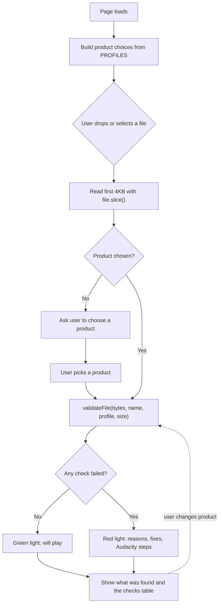

# Architecture

How the Audio File Checker works, for people reading the code. For the requirements and the decisions behind them, see [CLAUDE.md](CLAUDE.md).

## 1. Overview

The app is one web page that answers "Will this file play on my board?" The user picks a Robertsonics product and drops in a WAV file. The page reads the first 4KB of the file in the browser and checks the header against the product's rules. It then shows a **green light** (will play) or a **red light** (won't play), with every reason and a fix in Audacity.

There is no server. Everything runs in the user's browser, and the file never leaves their computer.

## 2. File map

| Path | Job |
|---|---|
| `index.html` | The page: product question, drop zone, result area, Audacity help. Sets the Content Security Policy. |
| `app.js` | The page's behaviour: reads the start of the file, calls the validator, shows the result. The only file that touches the page. |
| `validator.js` | The checking logic, as pure functions. Bytes and a file name go in, a result object comes out. No page code. |
| `profiles.js` | The rules for each product (sample rate, bit depth, channels), as data. |
| `styles.css` | The page's look, with light and dark mode. |
| `assets/` | Jamie's logo: `robertsonics-logo.png` (black) and `robertsonics-logo-white.png` (dark mode). |
| `tests/validator.test.js` | Tests for `validator.js`, mostly driven by the test corpus. |
| `tests/page.test.js` | Text checks on the page files (CSP, no external URLs, no modules, and so on). Does not run a browser. |
| `test-files/` | The test corpus: good and bad WAV files. |
| `test-files/manifest.json` | The expected result for every test file on every product, written by hand. |
| `tools/make-test-files.js` | Builds the script-made test files. Development only. |
| `reference/current-utility.js` | The old checker from robertsonics.com, kept for comparison only. Not used by the app. |
| `CLAUDE.md` | Requirements, Jamie's rules, decisions, and instructions for Claude Code. |
| `README.md` | Short introduction. |
| `.nojekyll` | Empty. Tells GitHub Pages to serve the files as they are, without running Jekyll. |
| `.gitignore` | Keeps macOS `.DS_Store` files out of the repo. |

## 3. How a check works

1. When the page loads, `app.js` builds one radio button per entry in `PROFILES` and fills in the general "How to create a compatible file" steps.
2. The user picks a product and drops a file on the drop zone, or chooses one with **Select file**. Only one file is checked. If several are dropped, the first is used and the page says so.
3. `useFile()` reads only the first 4KB: `file.slice(0, READ_BYTES).arrayBuffer()`. It keeps those bytes, the file name and the file's real size.
4. `showResult()` runs. With no product chosen yet, it asks the user to choose one. Otherwise it calls `validateFile(bytes, name, profile, size)`.
5. `validateFile()` runs every check and returns a result object (see section 4).
6. `showResult()` draws:
   * the light, in color **and** words;
   * what was found;
   * on red, every reason with its fix, then the Audacity steps;
   * a collapsed "Show all checks" table.
7. Changing the product reruns step 4 on the same bytes, with no need to drop the file again.
8. If the user goes back or forward in the browser, the `pageshow` event calls `clearFile()`, which forgets the file and hides the result.



## 4. validator.js

### What goes in and what comes out

`validateFile(headerBytes, filename, profile, fileSize)` is the only function the page calls.

| Input | Meaning |
|---|---|
| `headerBytes` | The start of the file, as a `Uint8Array` or `ArrayBuffer`. Anything past 4096 bytes is cut off, so the validator never looks further. |
| `filename` | The file's name, for the `.wav` check. |
| `profile` | One entry from `PROFILES`. |
| `fileSize` | The real size of the whole file. It tells the validator whether the bytes it has reach the end of the file. If it is left out, the bytes are treated as the whole file. |

It returns:

| Field | Meaning |
|---|---|
| `result` | `'green'` or `'red'`. Nothing else. |
| `headline` | The sentence shown next to the light. |
| `audioFormatCorrect` | True when encoding, bit depth, sample rate and channels all pass. A red headline then says "The audio format is correct (...), but:" followed by the actual reason. |
| `reasons` | The failed checks. Each has `id`, `label`, `message` and `fix`. |
| `checks` | Every check in a fixed order, each `pass`, `fail` or `skipped`. Used for the "Show all checks" table. |
| `detected` | Channels, sample rate, bit depth, format code, and whether metadata was found before the audio. `null` means it could not be read. |
| `audacitySteps` | Audacity steps tailored to what failed. Empty when the file is green, or when only the file name is wrong. |

### The rule: the 44-byte header

Jamie's rule ([CLAUDE.md, The rule](CLAUDE.md#the-rule-v1)) says a file plays only if it starts with the standard 44-byte WAV header. `hasCanonicalHeader(bytes, profile)` checks exactly this table:

| Bytes | Must be |
|---|---|
| 0 to 3 | `RIFF` |
| 4 to 7 | (file size, not checked) |
| 8 to 11 | `WAVE` |
| 12 to 15 | `fmt ` |
| 16 to 19 | fmt chunk size = 16 |
| 20 to 21 | Audio format = 1 (PCM) |
| 22 to 23 | Channels, as the product requires |
| 24 to 27 | Sample rate = 44100 |
| 28 to 33 | (byte rate and block align, not checked) |
| 34 to 35 | Bits per sample = 16 |
| 36 to 39 | `data` |

A file is green exactly when this table matches and the file name ends in `.wav` (any case). The tests check this for every test file on every product.

### Explaining a red light

The table says *whether* a file is red. To say *why*, the validator reads the file's structure:

* `walkChunks(bytes)` steps through the chunks after the 12-byte RIFF header. Each chunk is a 4-letter id, a 4-byte size, then that many bytes, plus a padding byte if the size is odd. The walk stops at `data`. Anything after the audio is never looked at, because the players ignore it too.
* `checkStructure()` uses the walk to check metadata, the audio data and the format chunk.
* `checkFormat()` reads the fmt fields and compares them with the profile.
* `checkExtension()` checks the file name. It is kept separate because it is Seth's decision, still pending Jamie, and may be removed.

Each check is made with `makeCheck(id, status, message, fix)`. Every reason that applies is reported, not just the first.

| Check id | Red when |
|---|---|
| `wav-file` | The file doesn't start with `RIFF` and `WAVE`. The other header checks are then skipped. |
| `metadata` | Any chunk other than the first `fmt ` comes before `data`. Also red if `data` isn't found within the first 4KB and the file is longer than that, which is reported as a large metadata block. |
| `audio-data` | No `data` chunk was found, and the whole file was read. If the file goes past 4KB, this check is skipped instead. |
| `fmt-chunk` | There is no `fmt ` chunk before `data`, or the chunk is shorter than 16 bytes. |
| `fmt-size` | The `fmt ` chunk is not exactly 16 bytes (for example 18-byte or extensible headers). |
| `format-code` | The format code is not 1 (PCM). For example, 3 is 32-bit float and 0xFFFE is extensible. |
| `bit-depth` | Bits per sample is not the profile's `bitsPerSample`. |
| `sample-rate` | The sample rate is not the profile's `sampleRate`. |
| `channels` | The channel count is not in the profile's `channels` list. |
| `extension` | The file name doesn't end in `.wav` (any case). |

**Safety net.** If the 44-byte table says red but none of the checks above failed, `validateFile()` adds a general `header-layout` reason, so a red file never appears without a reason. The tests confirm this is never needed for any test file.

### Audacity steps

`audacitySteps()` builds the steps for a red light:

* The main export steps are always included, with Channels naming what the chosen product needs.
* The Edit metadata step is added only when metadata was found before the audio.
* The 32-bit float note is added for bit depth or encoding problems.
* No steps are shown when only the file name is wrong.

`GENERAL_AUDACITY_STEPS` holds the steps for the help section on the page. The wording comes from [CLAUDE.md, Audacity guidance](CLAUDE.md#audacity-guidance), and the steps were tested with Audacity 4.0.2.

## 5. profiles.js

`PROFILES` is an object with one entry per product, keyed by the product's id:

```js
'wav-trigger': {
  id: 'wav-trigger',      // the same as the key
  name: 'WAV Trigger',    // shown on the page and in messages
  sampleRate: 44100,      // required sample rate in Hz
  bitsPerSample: 16,      // required bit depth
  channels: [2],          // allowed channel counts: 1 = mono, 2 = stereo
},
```

WAV Trigger Pro takes both, so its entry has `channels: [1, 2]`. The page lists products in the order they appear in this file. The values are Jamie's ([CLAUDE.md, Product profiles](CLAUDE.md#product-profiles-confirmed-by-jamie)).

## 6. Making changes

### Add a product

1. Get the rules confirmed by Jamie, and add the product to the "Product profiles" table in CLAUDE.md.
2. Add an entry to `PROFILES` in `profiles.js`. The page picks it up automatically.
3. In `test-files/manifest.json`, add the id to `products`, and add an expected result for the new product to **every** file. The tests fail until every file has one.
4. If the product needs more than the existing channel options, update the general Channels step in `AUDACITY_STEPS` in `validator.js`, which names the products.
5. Run `node --test`.

### Add a rule

1. Get the rule approved and record it in CLAUDE.md. Never add a rule that isn't there.
2. In `validator.js`, add an entry to `CHECKS`. Its position sets its order in the "Show all checks" table.
3. Write the check, using `makeCheck()` with a plain-English message and a fix that points to Audacity, and add it to the checks list in `validateFile()`. If the rule is part of the 44-byte header, update `hasCanonicalHeader()` too.
4. Add a test file that breaks only this rule. Either add it to `buildCorpus()` in `tools/make-test-files.js` and run `node tools/make-test-files.js`, or make it in real software and mark it `"builtBy": "hand"`.
5. Add the file to `manifest.json` with its expected result on every product. Then update the list of check ids in the test "the show-all-checks list is exactly the v1 rules".
6. If the fix needs its own Audacity step, add it to `audacitySteps()`.
7. Run `node --test`, and update this file.

## 7. Tests

Run from the project folder (needs Node.js, which is only a development tool):

```
node --test
```

This runs both files in `tests/` with Node's built-in test runner. There is no test framework and no `npm install`.

**The test corpus.** `test-files/` holds known good and known bad WAV files. Each bad file has exactly one problem.

* Most files are built by `tools/make-test-files.js`. The output is the same every time, and a test fails if a file on disk differs from what the script builds.
* Files made in real software, such as Seth's Audacity 4.0.2 exports (`audacity4_*.wav`), are marked `"builtBy": "hand"`. The script never touches them.

**manifest.json.** For each file it records:

* `problem`: what's wrong with it, in words.
* `builtBy`: `"script"` or `"hand"`.
* `expected`: for each product, either `"green"` or `{ "result": "red", "because": [check ids] }`.
* `confirmedOnHardware`: the products on which the result was seen on a real board.

The expected results are written by hand from the rules, never copied from the validator's output, so the tests compare the code against the rules.

The tests read each file the way the app does: only the first 4KB, plus the real file size. Beyond the corpus, they also check:

* Every file on disk is in the manifest, and the other way round.
* Every check is failed by at least one test file.
* The checks always agree with the 44-byte table.
* Each bug in the old utility is handled ([CLAUDE.md, Known problems](CLAUDE.md#known-problems-in-the-current-utility-do-not-repeat)).
* Short or cut-off files never cause an error.
* The Audacity steps match CLAUDE.md.
* The page files keep the constraints in section 9.

## 8. Running it

**On your computer.** Download or clone the repo and double-click `index.html`. It opens from `file://` with no web server and no install. This is how Jamie tests it before launch.

**On GitHub Pages.** Pages serves the repo root as plain static files. There is no build step. `.nojekyll` makes Pages serve the files exactly as they are. Every path is relative (`app.js`, `assets/robertsonics-logo.png`), so the same files work from a double-click, from a GitHub Pages address, or later from a custom domain. During development the repo is private; it becomes public at launch ([CLAUDE.md, Tech stack](CLAUDE.md#tech-stack)).

## 9. Design constraints and why

* **Files never leave the computer.** Customers' audio is theirs. The page reads the file with the browser's File API and never sends it anywhere.
* **No network.** A Content Security Policy in `index.html` lets the page load only its own files and blocks every connection (`connect-src 'none'`). Even a bug, or a future change, can't upload a file. For the same reason there are no analytics, CDNs or web fonts.
* **No dependencies.** The app is plain HTML, CSS and JavaScript: no framework, no build step, no packages. Anyone can read it, and there is nothing to update or break. Node.js is used only to run the tests and build test files.
* **Works from `file://`.** Browsers block JavaScript modules (`import`) on `file://`, so the scripts are loaded with plain `<script src>` tags in order: `profiles.js`, `validator.js`, `app.js`. The first two define globals (`PROFILES`, `validateFile`, `READ_BYTES` and others) that `app.js` uses. The line at the end of `profiles.js` and `validator.js` that sets `module.exports` lets the Node tests load the same files.
* **Only the start of the file is read.** The players decide from the header and never look past the audio data, so the checker doesn't either. The green/red decision needs only the first 44 bytes. The app reads 4KB so it can also name a metadata block, and it stays fast with very large files.
* **The validator has no page code.** Keeping `validator.js` pure means every rule can be tested in Node without a browser.
